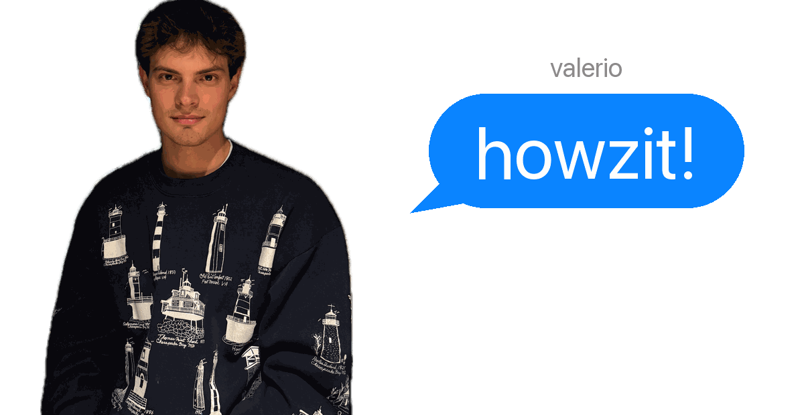

  

 

i'm valerio, a south african studying at bocconi in milan. mostly i do nlp and data work, and every now and then i build a small site because i wanted to see something on a map or keep something from getting lost.

i write python most days, plus some typescript, sql and swift. for ml it's pytorch, hugging face, spacy, scikit-learn, pandas and numpy.

### things i've made

<table>
<tr>
<td width="33%" valign="top">

 <b><a href="https://github.com/calerio/stardew-valley-afrikaans">stardew valley in afrikaans</a></b> 
the whole game translated, with 99 signs redrawn by hand. also on <a href="https://www.nexusmods.com/stardewvalley/mods/54293">nexus mods</a>.
</td>
<td width="33%" valign="top">

 <b><a href="https://github.com/calerio/western-cape-valuations">western cape valuations</a></b> 
a map of municipal property valuations across the western cape. <a href="https://calerio.github.io/western-cape-valuations/">live site</a>.
</td>
<td width="33%" valign="top">

 <b><a href="https://github.com/calerio/pokemon-tcg-pocket-deck-builder">pocket deck lab</a></b> 
build a pokémon tcg pocket deck and get the qr code the game scans. <a href="https://calerio.github.io/pokemon-tcg-pocket-deck-builder/">try it</a>.
</td>
</tr>
</table>

also:

- [t812-archive](https://github.com/calerio/t812-archive): polaroids, letters and memories from flat t812 ([live site](https://calerio.github.io/t812-archive/))
- [dog-whistle-detection](https://github.com/calerio/dog-whistle-detection): my bocconi nlp project on disambiguating dog whistles in the *silent_signals* corpus
- [claude-skills](https://github.com/calerio/claude-skills): skills for claude code that i tinker with
- [Mini-Briscola](https://github.com/calerio/Mini-Briscola): briscola, the italian card game

### elsewhere

[linkedin](https://www.linkedin.com/in/valerioc) · [instagram (@va1eriocosta)](https://instagram.com/va1eriocosta) · [hugging face](https://huggingface.co/calerio)
